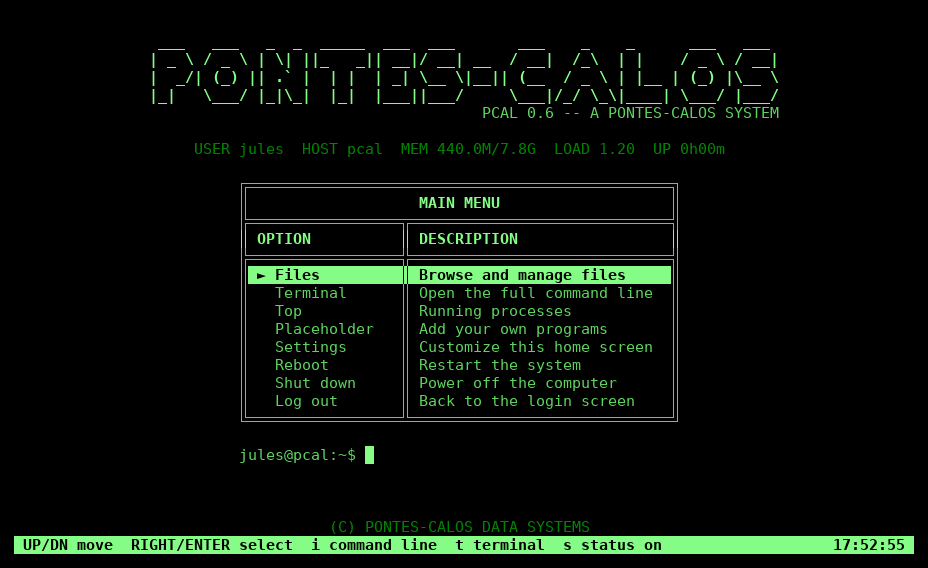
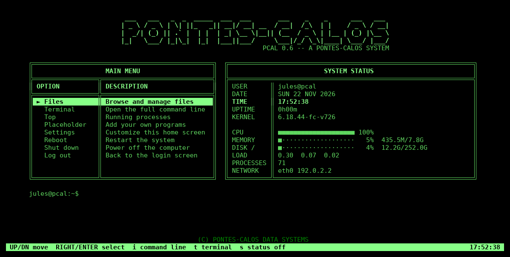
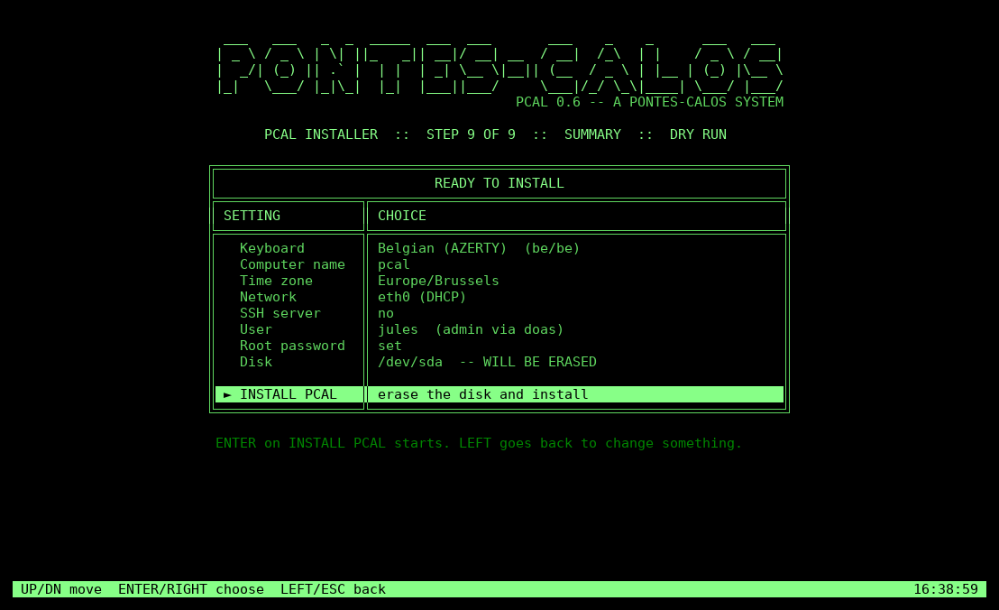

# PCal (Pontes-Calos)

A lightweight Linux, built on Alpine, that boots into a retro green-phosphor terminal:
a boxed arrow-key menu, its own login screen and installer, and CRT effects, all in text mode.
No desktop, no window system: fast, and easy to understand.


| Startup | Shutdown |
|---|---|
|  |  |

*Recorded from the real program with Settings › Effects set to FULL.*

## What's in it

- **Home menu**: files, terminal, process monitor, your own programs (plugins), settings, reboot, shut down, log out.
- **Command line under the menu**: press `i`, type a command, see its output without leaving the menu. Programs that need the whole screen (`vim`, `top`, `ssh`...) get it automatically.
- **File manager**: `ls -l` style list with permissions, size and date; open, view, edit, rename, delete, file details, terminal here.
- **SYSTEM STATUS panel** (`s`): CPU, memory and disk bars, load, network address, uptime, battery and temperature on laptops.
- **RetroLogin**: the login screen on tty1. It checks your password like the normal login, and slows down guessing.
- **PCal installer** on the ISO: Alpine's own setup with PCal's screens.
- **The Desk** (in the graphical screen): a command deck with numbered modules that open in a window, live system meters, an event log and a taskbar.
- **Looks**: green, amber, white or cyan themes; double, single or ASCII boxes; CRT power on/off, phosphor afterglow, typewriter text; on the real Linux console, PCal repaints the console's own colours.
- **Light**: the release build needs no Python on the system, and the status panel reads `/proc` and `/sys` without starting programs.



## Install PCal

1. Build the ISO (see [Building](#building)), or take one from a release.
2. Boot it in a virtual machine or from a USB stick: it starts straight into the PCal menu, in the graphical CRT screen (text mode if the graphics can't work; Settings › Display switches).
3. Choose **Install PCal** and answer the questions: keyboard, computer name, time zone, network, SSH, your user and password, root password, disk (type `YES` to erase it).
4. Remove the ISO and reboot. On the first start PCal finishes its setup by itself, then shows the login screen.



Already running Alpine? [`distro/install.sh`](distro/README.md) (`pcal-setup`) turns an existing install into PCal.

## Keys

| Where | Keys |
|---|---|
| Everywhere | `↑` `↓` move (also `k` `j`) · `→` / `Enter` open (also `l`) · `←` / `Esc` back (also `h`) |
| Main menu | `i` type a command · `t` full terminal · `s` show/hide SYSTEM STATUS |
| Command line | `Enter` run · `!cmd` run in the full terminal · `↑` `↓` history · `PgUp` `PgDn` scroll output · `Esc` back to the menu |
| File manager | `Enter` actions · `→` open folder · `←` up · `.` hidden files · `t` terminal here · `q` back |
| Login screen | `Tab` / `Enter` next field · `Esc` clear · `Alt+F2` the normal console login |

## Repository

| Folder | What |
|---|---|
| [`retromenu/`](retromenu/) | the programs, pure Python standard library: `retromenu.py` (menu), `retrologin.py` (login screen), `retroinstall.py` (installer), `pontes.py` (one program that runs them all, like busybox) |
| [`build/`](build/) | turns the Python code into a self-contained program (PyInstaller) |
| [`packaging/alpine/`](packaging/alpine/) | turns that program into the Alpine package `pcal-*.apk` |
| [`iso/`](iso/) | builds the bootable PCal ISO with Alpine's `mkimage` |
| [`distro/`](distro/) | `install.sh` = `pcal-setup`: login screen, menu autostart, console font, doas rule |
| [`tests/`](tests/) | smoke test that drives the real program through a pseudo-terminal |

## Building

Everything is built on Alpine (a VM is fine), as your normal user. The guides have the one-time setup.

```sh
sh build/build.sh                   # 1. the program (no Python needed to run it; apk add py3-numpy first, for the graphical screen)
sh packaging/alpine/build-apk.sh    # 2. the pcal package          → dist/apk/pcal/
sh iso/build-iso.sh --virt          # 3. the ISO for VMs           → dist/iso/pcal-virt-*.iso
sh iso/build-iso.sh                 #    or for real PCs (needs ~6 GB free while building)
```

Details: [`build/build.sh`](build/build.sh) · [package](packaging/alpine/README.md) · [ISO](iso/README.md).

## Developing

Run the source directly: no build needed.

```sh
python3 retromenu/retromenu.py                            # the menu
python3 retromenu/retrologin.py --login-cmd /bin/true     # the login screen, safe to try
python3 retromenu/pontes.py install --dry-run             # the installer, changes nothing
python3 tests/smoke_test.py python3 retromenu/pontes.py   # quick check before a PR
```

A good setup is two VMs: a **dev VM** where you build (with the normal login on tty1, so a login-screen
bug can't lock you out: `doas pcal-setup --uninstall`), and a **test VM** installed from the ISO.

To release: bump `VERSION` in `retromenu/retromenu.py`, build, and publish `dist/release/*` as a GitHub
Release tagged `vVERSION`. The installer downloads `pontes-calos-linux-x86_64-musl.tar.gz` from there.

## Roadmap

1. ~~Retro menu as a standalone program~~
2. ~~Login screen on tty1, menu after login~~
3. ~~Self-contained release program (no Python on the system)~~
4. ~~Alpine package and bootable ISO~~
5. ~~PCal installer on the ISO~~
6. Font size setting for big screens, keyboard layout in Settings, help card (`F1`)
7. Wi-Fi in the installer and the menu
8. ARM build (Raspberry Pi)
9. A real CRT renderer: glow, scanlines and curvature on the bare console

## License

PCal (Pontes-Calos) is free software: you can redistribute it and/or modify it under the terms of the
**GNU General Public License, version 3 or (at your option) any later version**. See [`LICENSE`](LICENSE).

In short: anyone may use, study, share and change PCal. If you share a changed version, or binaries
built from it, you must share the source code too, under the same license.
