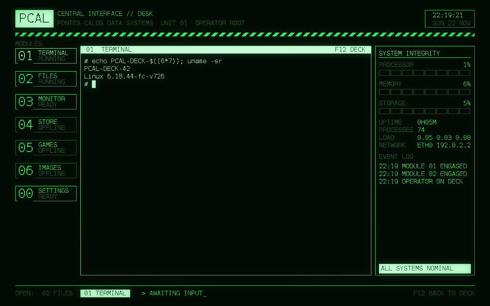

# PCal (Pontes-Calos)

**A lightweight Linux distribution with a retro phosphor terminal for a desktop.**

PCal is built on [Alpine Linux](https://alpinelinux.org). It boots into a green (or amber) CRT-style
interface: a keyboard-driven home menu, its own login screen and installer, and a graphical
CRT screen with glow, scanlines and a curved tube, drawn straight to the display without X or Wayland.

[**Download the latest release**](https://github.com/bababoy06/PCal-terminal/releases/latest) ·
[Installation guide](docs/installation.md) ·
[Development guide](docs/development.md) ·
[License: GPL-3.0](LICENSE)

| Startup | Shutdown |
|---|---|
|  |  |

## Features

**The interface**
- **Home menu** with arrow and vim keys: the Desk, files, terminal, process monitor, your own programs (plugins), settings, reboot, shut down and log out.
- **Command line under the menu**: press `i`, run a command and read its output without leaving the menu. Full-screen programs (`vim`, `top`, `ssh`) get the whole screen automatically.
- **File manager**: an `ls -l` style list with open, view, edit, rename, delete, details and "terminal here".
- **SYSTEM STATUS panel** (`s`): CPU, memory and disk meters, load, network, uptime, battery and temperature.

**The graphical screen**
- A real CRT renderer on the Linux framebuffer: phosphor glow, scanlines, curved glass, afterglow, and the power on/off effect. It falls back to text mode automatically when graphics are unavailable.
- **The Desk**: a command deck with numbered modules that open in a window, live system meters, an event log and a taskbar.

**The system**
- **RetroLogin**: a login screen that checks passwords like the standard login and slows down guessing.
- **PCal installer** on the ISO: Alpine's own setup tools behind PCal's screens.
- **Personal**: themes (green, amber, white, cyan), box styles, effect levels, font size, and a custom title, both system-wide and per user.
- **Light and fast**: the release program brings its own Python, and the status readouts come straight from `/proc` and `/sys`.

## Quick start

1. Download the ISO from the [latest release](https://github.com/bababoy06/PCal-terminal/releases/latest) (`pcal-virt-VERSION-x86_64.iso`) and its `.sha256` file.
2. Boot it in a virtual machine (VirtualBox: Graphics Controller **VMSVGA**). PCal starts on its own.
3. Choose **Install PCal**, answer the questions, and reboot when it's done.

The [installation guide](docs/installation.md) covers each step in detail, as well as real hardware,
installing on an existing Alpine system, updating, and troubleshooting.

## Keys

| Where | Keys |
|---|---|
| Everywhere | `↑` `↓` move (also `k` `j`) · `→` / `Enter` open (also `l`) · `←` / `Esc` back (also `h`) |
| Main menu | `i` type a command · `t` full terminal · `s` show/hide SYSTEM STATUS |
| Command line | `Enter` run · `!cmd` run in the full terminal · `↑` `↓` history · `PgUp` `PgDn` scroll output · `Esc` back to the menu |
| File manager | `Enter` actions · `→` open folder · `←` up · `.` hidden files · `t` terminal here · `q` back |
| The Desk | `0`–`9` open a module · `Tab` next window · `X` close · `F12` from a module back to the Desk · `Q` back to the menu |
| Login screen | `Tab` / `Enter` next field · `Esc` clear · `Alt+F2` the standard console login |

## Releases

Stable versions are published on the [releases page](https://github.com/bababoy06/PCal-terminal/releases).
Each release contains:

| File | Use it for |
|---|---|
| `pcal-virt-VERSION-x86_64.iso` | the bootable live and install image, for virtual machines |
| `pcal-VERSION-rNUMBER.apk` + `APKINDEX.tar.gz` | installing or updating PCal on an existing Alpine system |
| `pontes-calos-linux-x86_64-musl.tar.gz` | the self-contained program, used by `distro/install.sh` |
| `pontes-linux-x86_64-musl` | the same program as a single file |
| `*.sha256` | checksums to verify the downloads |

Want changes that aren't released yet? The [development guide](docs/development.md) explains how to build
the program, the package and the ISO yourself from `main`.

## Documentation

| Guide | Contents |
|---|---|
| [Installation guide](docs/installation.md) | requirements, downloading and verifying, virtual machines, real hardware, existing Alpine, first start, updating, troubleshooting |
| [Development guide](docs/development.md) | the build machine, running from source, tests, building the release program, package and ISO, publishing a release |
| [`retromenu/`](retromenu/README.md) | the programs and their options |
| [`distro/`](distro/README.md) | `pcal-setup`: what it changes on a system, login modes, safety net |
| [`packaging/alpine/`](packaging/alpine/README.md) | the Alpine package |
| [`iso/`](iso/README.md) | the ISO: what is on it and how the installer works |

## Roadmap

Done: the menu, the login screen, the self-contained program, the Alpine package and ISO, the installer,
the graphical CRT screen, and the Desk.

Next:
- The Desk: overlapping and resizable windows, the entry animation, mouse support
- Software store, games and a phosphor image viewer as Desk modules
- Keyboard layout in Settings and a help card (`F1`)
- Wi-Fi in the installer and the menu
- An ISO for real hardware in the releases, and an ARM build (Raspberry Pi)

## License

PCal (Pontes-Calos) is free software: you can redistribute it and/or modify it under the terms of the
**GNU General Public License, version 3 or (at your option) any later version**. See [`LICENSE`](LICENSE).

Copyright (C) 2026 bababoy06
