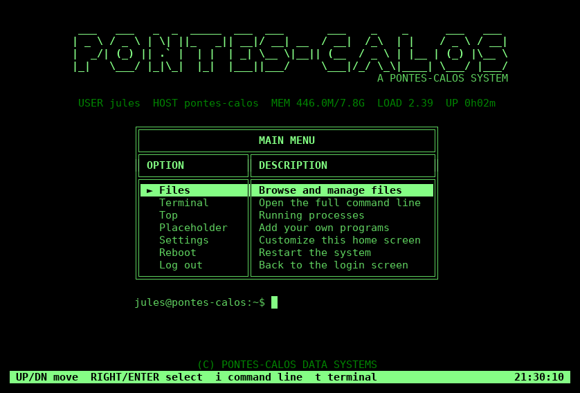

# Pontes-Calos

A lightweight, speed-optimized Linux (Alpine-based) with a retro green-CRT, arrow-key home menu and login screen.



| Startup | Shutdown |
|---|---|
|  |  |

*Recorded from the real program with Settings > Effects set to FULL.*

## Components

- [`retromenu/`](retromenu/): the programs. Pure Python stdlib.
  - `retromenu.py`: the home menu (file manager, command line, terminal, monitor, plugins, settings, reboot)
  - `retrologin.py`: the login screen on tty1
  - `pontes.py`: one program that runs both (`pontes menu`, `pontes login`), the way busybox does
- [`distro/`](distro/): installer that turns a fresh Alpine install into Pontes-Calos.
- [`build/`](build/): turns the Python code into a self-contained program (no Python needed).
- [`tests/`](tests/): smoke test that drives the real program through a pseudo-terminal.

## Develop with Python, release a program

**While developing**, just run the source, no build needed:

```sh
python3 retromenu/retromenu.py           # the menu
python3 retromenu/retrologin.py --login-cmd /bin/true   # the login screen, safe to try
python3 tests/smoke_test.py python3 retromenu/pontes.py  # quick check before a PR
```

**To release**, bump `VERSION` in `retromenu/retromenu.py`, merge, then tag:

```sh
git tag v0.4 && git push origin v0.4
```

GitHub Actions then builds and tests:

| File | For |
|---|---|
| `pontes-calos-linux-x86_64-musl.tar.gz` | Pontes-Calos / Alpine. This is what the installer downloads. |
| `pontes-linux-x86_64-musl` | single file for Alpine: copy and run |
| `pontes-linux-x86_64-glibc` | single file for Debian, Ubuntu, Fedora, Arch... |
| `pontes-calos-linux-x86_64-glibc.tar.gz` | folder version of the same |
| `*.sha256` | checksums (the installer checks them) |

and publishes them as a GitHub Release.

The **folder build** (`.tar.gz`) starts fastest. It's what the distro uses, because the login screen and menu start again after every logout. The **single file** unpacks itself to `/tmp` on every start, so it's a bit slower, but you can copy one file anywhere and run `./pontes menu`.

Building on your own machine: `pip install pyinstaller && sh build/build.sh`. A build only runs on the same C library it was made on: build on Alpine for musl, on Debian/Ubuntu for glibc.

## Roadmap

1. ~~RetroMenu as a standalone app~~
2. ~~Alpine install: login screen on tty1, then RetroMenu (`distro/install.sh`)~~
3. ~~Self-contained release program (no Python on the system)~~
4. Custom ISO built with `mkimage`
5. ARM build (Raspberry Pi)
